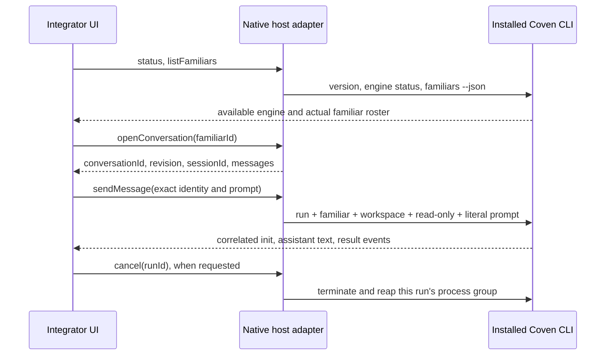

# Connect Coven Familiars

Open Sesame is a reference consumer of Coven’s installed CLI, using the pinned MIT OpenCoven Chat runtime interface through a native host adapter. Coven supplies familiar discovery, identity context, workspace selection, provider sign-in, and harness execution. Open Sesame supplies the picker, composer, streamed rendering, cancellation, and its own local conversation history. The reference host targets macOS and Linux; another platform can provide the same host contract with its own process and storage adapter. This integration does not depend on Cave, a published SDK messaging endpoint, or a second set of model API keys.

## Try the happy path

1. Install and configure [Coven](https://github.com/OpenCoven/coven) on your machine. Confirm `coven --version`, `coven engine status --json`, and `coven familiars --json` work. An empty roster needs a familiar first; `coven familiar create "Example" --json` is Coven’s creation command. Provider login stays in Coven’s terminal setup.
2. Open Open Sesame Desktop, choose **Console → Familiars**, and click **Connect Coven**. Open Sesame checks the CLI and engine, then lists the complete installed familiar roster. The Plugins catalog also has a Coven Familiars entry that opens the same flow.
3. Choose a familiar. Open Sesame reads that familiar’s saved conversation and restores its draft. Connecting, refreshing, choosing, and reopening never start a provider turn. After the first successful connection, app relaunch restores this local connection and selected familiar through read-only discovery.
4. Type a message, review the chosen familiar’s name and the Run with choice, and press **Send**. Enter sends; Shift–Enter adds a line. The microphone prepares a draft for review. A reply streams into this familiar’s conversation.
5. Use **Stop** to cancel the current reply while preserving text already captured. Switch familiars to keep separate histories and drafts. A later Send continues the selected familiar’s own conversation. This application keeps one persistent conversation per familiar; reset actions are removed.

Messages use the familiar’s dedicated workspace with `--permission read-only`. The renderer cannot supply working directories, executable paths, permission settings, model credentials, or arbitrary CLI arguments. First-time conversations use the installed Coven Code engine, and your Run with choice is remembered per familiar; Codex and Claude Code are also supported where configured. Once a chat has a Coven session, its harness remains fixed for that persistent conversation.

## Run the small integration example

From the source checkout, list your actual familiars without running a provider:

```sh
python3 -B examples/coven_familiars.py --list
```

Then explicitly send to one exact id returned by that list:

```sh
python3 -B examples/coven_familiars.py --familiar YOUR_FAMILIAR_ID --message "Hello. What can you help me with?"
```

The example imports the same `CovenRuntime` adapter as the application. It prints JSONL stream events and the final session identity. Its conversation storage is separate from the application’s storage. Sending another message with the same familiar id continues the example’s conversation; `--harness codex` or `--harness claude` can choose a harness for a fresh example chat. Ctrl+C exits through cleanup. The message argument is explicit: listing never sends a greeting or test prompt.

## Integrate the browser client with your native host

The reference files are:

| File | Responsibility |
| --- | --- |
| `vendor-src/coven-chat/coven-runtime.ts` | Unchanged upstream runtime interface pinned to Chat `a8c76390ff946389224b86e5ff91b8b6c11bf413`. |
| `dist/coven-chat.js` | Maps that interface to a request/event transport and filters stream events by run, familiar, and conversation. |
| `desktop/coven_runtime.py` | Validates host requests, reads Coven’s roster, runs the CLI, checks session identity, stores consumer history, and reaps cancelled processes. |
| `desktop/bridge.py` | Dispatches allowlisted operations on bounded workers and delivers replies/events without blocking Stop. |
| `dist/familiars.js` | The product happy path: connect, choose, compose, stream, stop, reopen. |
| `examples/coven_familiars.py` | Minimal executable consumer of the same adapter. |
| `scripts/check-coven-client.mjs` | Complete JavaScript client → Python host → deterministic CLI fixture acceptance path. |



Load the bundled runtime interface and client adapter, then inject your host’s `request(method, params)` and event subscription. In Open Sesame, the already constructed client is `window.OpenSesameCovenClient`:

```js
const client = window.OpenSesameCovenClient;
const status = await client.status();
if (!status.available) throw new Error(status.error);
const familiars = await client.listFamiliars();
// Use a familiar chosen by the person in your UI, not an assumed default id.
const chat = await client.openConversation(chosenFamiliarId);
await client.sendMessage({
  runId: crypto.randomUUID(),
  familiarId: chosenFamiliarId,
  conversationId: chat.conversationId,
  revision: chat.revision,
  sessionId: chat.sessionId,
  harness: chat.harness,
  prompt: reviewedMessage,
}, event => renderCovenEvent(event));
// Read again after completion, cancellation, or an error to refresh the revision.
const updatedChat = await client.openConversation(chosenFamiliarId);
```

For another host, `window.OpenSesameCreateCovenClient(transport, subscribe)` constructs the same client. `transport.available` is a Boolean. `transport.request` returns a Promise for a host result; `subscribe(listener)` returns an unsubscribe function and delivers the host event envelopes below. Close the client when disposing its view. Use a unique run id for every explicit Send, and retain it for `client.cancel(runId)`.

### Host operations

| Operation | Request | Result |
| --- | --- | --- |
| `coven.status` | `{}` | `available`, CLI `version`, `transport: "cli"`, and an actionable setup error if needed. |
| `coven.familiars` | `{}` | Actual roster entries: `id`, `name`, `displayName`, optional description/emoji/workspace. |
| `coven.open` | `familiarId` | Consumer-owned `conversationId`, exact `familiarId`, current `sessionId` or null, `revision`, harness, messages, and status. |
| `coven.send` | The explicit send object above | `runId`, Coven’s resulting `sessionId`, and init/completion events. Text is delivered through the stream and persisted in the conversation. |
| `coven.cancel` | `runId` | Cancellation acknowledged; await the send request’s final settlement before another turn. |
| `coven.command` | `familiarId`, fixed command `name` | Bounded local status, sessions, familiars or skills metadata; no provider turn. |

Stream envelopes have `event: "coven.event"`, `runId`, `familiarId`, `conversationId`, and `payload`. The payload is a validated Coven `system` init, a cumulative `assistant` text snapshot, a `result`, or a short `notice`. Render snapshots as updates to the current assistant turn; they are not additional messages on every event. Other familiars’ events and stale run ids must not update the active answer. Raw tool arguments and stderr are not streamed into the product UI.

The host resolves the familiar from a fresh Coven roster and compares the stored conversation id, revision, familiar id, session id, harness, and canonical workspace before resuming. A changed workspace, mismatched session metadata, unfinalized previous reply, stale UI, missing familiar, or unsupported parameter stops the turn. An error is not converted into an unscoped fresh message. The application never silently replaces this persistent conversation.

### Context and storage

Coven Code’s print-mode engine does not natively reopen a threaded chat in the verified contract. As OpenCoven Chat does, this consumer replays recent text: at most 24 KiB of history, with at most 4 KiB per message, followed by the current prompt. See [persistent chat and commands](familiar-chat-commands.md) for the current UI and application-origin context. Codex and Claude Code use their native Coven continuation and receive the current prompt without replay. These behaviors were checked against the installed Coven 0.4.10 / Coven Code 0.8.0 help and the pinned Chat bridge; older or changed contracts must confirm workspace and permission fields before a reply is accepted.

On macOS, Open Sesame owns `~/Library/Application Support/Open Sesame/familiars/<familiar-id>/head.json`; Linux uses the corresponding XDG data directory. Files are private to the current user and replaced atomically. Each familiar has a cross-process lock, up to 120 recent messages and 512 KiB of stored message text. Messages are limited to 32 KiB of UTF-8 input and 64 KiB of reply text; an oversized reply stops with an explicit error and preserves the captured portion. Older turns are preserved in private history segments under the same conversation identity before the active context is trimmed. Existing older archives are preserved. Every turn includes host-generated Open Sesame application context. Coven’s own session ledger remains authoritative for session metadata. This consumer does not modify OpenCoven Chat’s canonical head files or claim SDK mission/identity-ledger semantics.

The desktop host exposes these operations only to its bundled top-level UI. Embedded websites receive no application bridge. The development WebSocket host is loopback-only and checks the page origin; it is a local development tool, not a public messaging server.

## Verify an integration

```sh
npm run check
python3 -B -m unittest desktop.tests.test_coven_runtime -v
OPEN_SESAME_VERSION=0.0.13 bash desktop/build-macos.sh
```

The protocol fixture covers actual child-process JSONL delivery, full roster discovery, no automatic sends, literal prompt arguments, read-only confirmation, per-familiar context, continuation, stale revisions, workspace/session identity mismatches, provider errors, malformed and oversized output, timeouts, partial text after cancellation, cancellation before start, process reaping, and preserved archives. The JavaScript client test runs the same Python bridge end to end and checks parallel familiar isolation. These are deterministic fixture-provider checks, not inference from a live model.

This development session verified the installed CLI, installed engine, running daemon, and discovery of all 10 locally configured familiars through read-only commands. No test message was sent to those familiars. Actual provider inference and native GUI acceptance remain to be exercised by a person pressing Send in the app; fixture tests and compilation do not establish those results.
